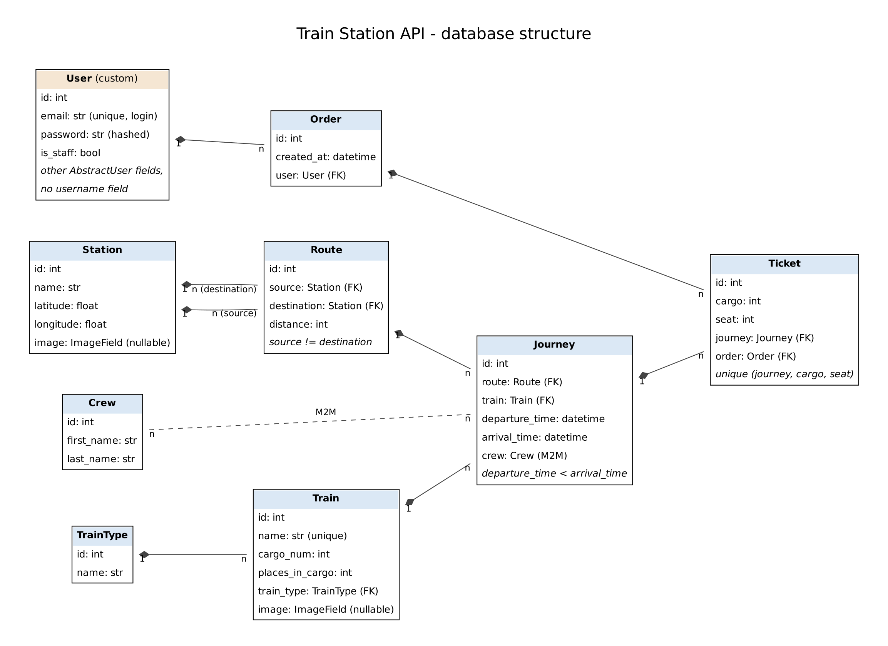
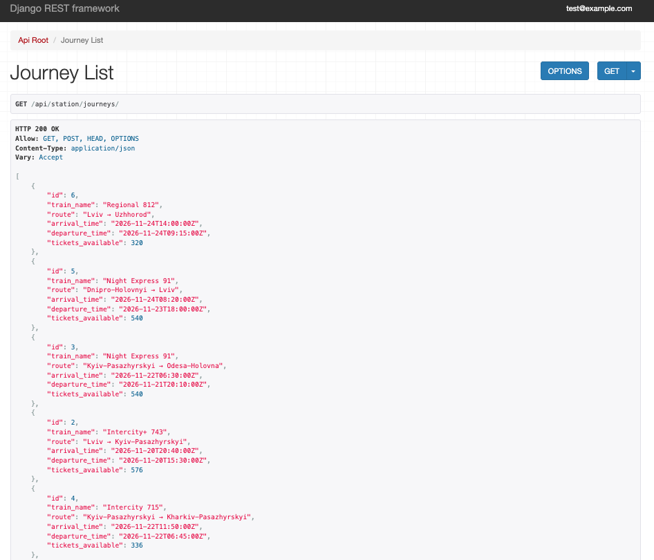
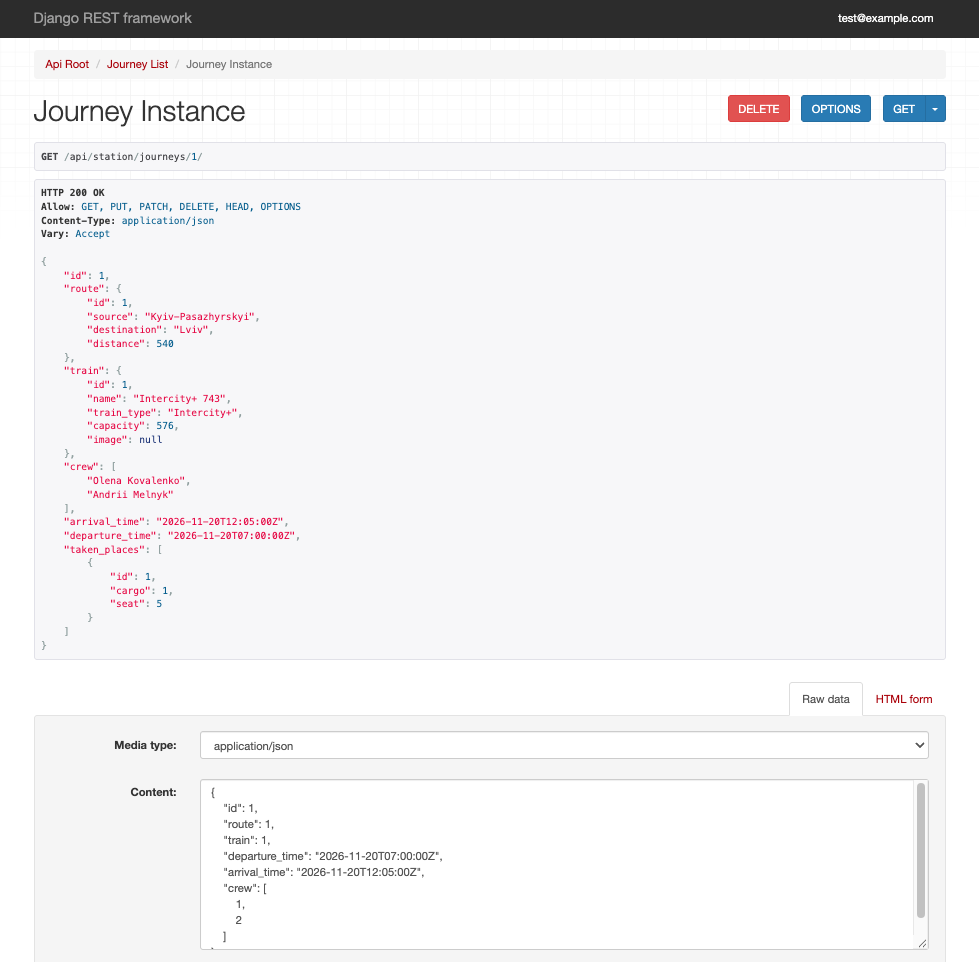
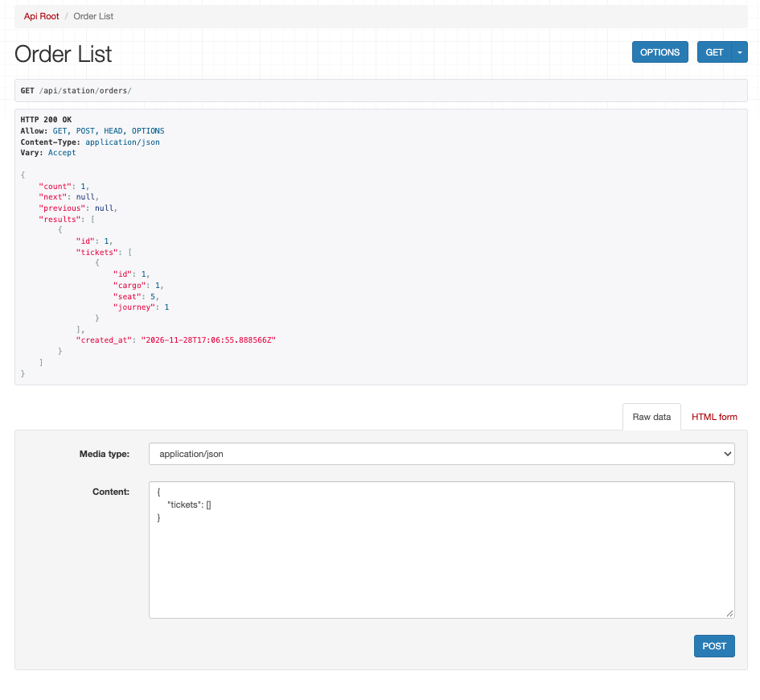
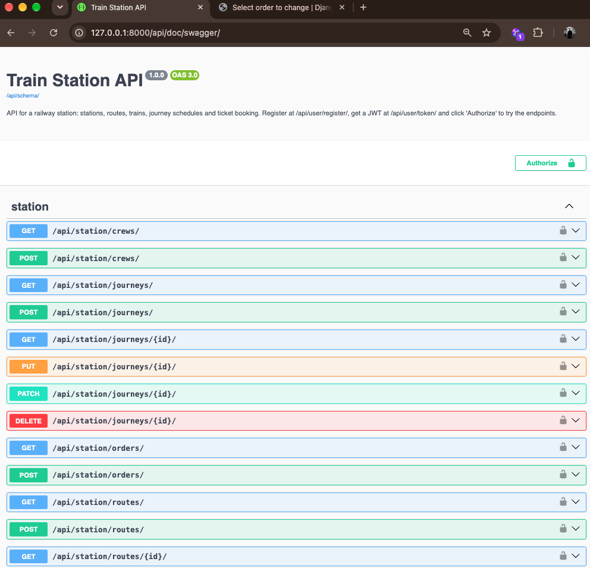

# Train Station API

REST API for a railway station: stations, routes, trains, crews, journey
schedules and ticket booking.

Built with Django REST Framework, JWT authentication, PostgreSQL and Docker.

## Features

- **JWT authentication**: registration, access/refresh tokens, token
  verification, `/me/` endpoint to view and update your own profile
- **Custom user model**: login by email instead of username
- **Permissions**:
  - anonymous users: only registration and getting a token
  - authenticated users: read stations, routes, trains, journeys etc.,
    create and view **their own** orders
  - admins: full access, including creating stations, routes, trains and
    journeys and uploading images
- **Ticket booking**: an order is created with one or more tickets in a
  single request (inside a database transaction)
- **Validation**:
  - a route cannot start and end at the same station
  - departure time must be earlier than arrival time
  - cargo and seat numbers must exist in the train
  - the same seat on the same journey cannot be booked twice
- **Journey list** shows `tickets_available` (calculated in the database);
  **journey detail** shows already taken places
- **Filtering**:
  - journeys by date, departure station and arrival station
  - routes by departure and arrival station
  - station names are matched partially and case-insensitively
    (`?source=kyiv` finds `Kyiv-Pasazhyrskyi`)
- **Image upload** for stations and trains (admin only)
- **Pagination** for orders
- **Throttling**: 100 requests/day for anonymous users,
  1000 requests/day for authenticated users
- **API documentation** with Swagger (drf-spectacular), including filter
  parameters
- **Docker**: the app and PostgreSQL run in containers, the app waits for the
  database with a custom `wait_for_db` command

## Tech stack

Python 3.11, Django 5.2, Django REST Framework, Simple JWT, drf-spectacular,
PostgreSQL 16, Pillow, Docker, docker-compose.

## How to run locally

Requirements: [Docker](https://www.docker.com/) with docker-compose.

1. Clone the repository:

   ```bash
   git clone https://github.com/AndriiOne/train-station-api.git
   cd train-station-api
   ```

2. Create a `.env` file from the sample and fill in your own values:

   ```bash
   cp .env.sample .env
   ```

3. Build and start the containers:

   ```bash
   docker-compose up --build
   ```

   Migrations are applied automatically on start.

4. In another terminal, load sample data (stations, routes, trains, crews,
   journeys):

   ```bash
   docker-compose exec app python manage.py loaddata train_station_data.json
   ```

5. Create an admin user:

   ```bash
   docker-compose exec app python manage.py createsuperuser
   ```

The API is available at http://127.0.0.1:8000/api/

## Getting access

1. Register a user:

   `POST /api/user/register/`

   ```json
   {
       "email": "user@example.com",
       "password": "yourpassword"
   }
   ```

2. Get a token pair:

   `POST /api/user/token/` with the same email and password. The response
   contains `access` and `refresh` tokens.

3. Send the access token in the header of every request:

   ```
   Authorization: Bearer <access token>
   ```

   The access token lives 5 minutes. To get a new one, send the refresh token
   to `POST /api/user/token/refresh/`. The refresh token lives 1 day.

To try admin-only endpoints (creating objects, uploading images), get a token
for the user created with `createsuperuser`.

**In Swagger**: open http://127.0.0.1:8000/api/doc/swagger/, get a token with
`POST /api/user/token/`, click **Authorize** and paste the access token.

**In the Browsable API**: the API uses only JWT, so add the
`Authorization: Bearer <access token>` header with a browser extension such
as [ModHeader](https://modheader.com/).

## API endpoints

### User

| Method | Endpoint | Description |
|---|---|---|
| POST | `/api/user/register/` | Register a new user |
| POST | `/api/user/token/` | Get access and refresh tokens |
| POST | `/api/user/token/refresh/` | Get a new access token |
| POST | `/api/user/token/verify/` | Check if a token is valid |
| GET, PUT, PATCH | `/api/user/me/` | View or update your profile |

### Station

| Method | Endpoint | Description |
|---|---|---|
| GET, POST | `/api/station/stations/` | List / create stations |
| POST | `/api/station/stations/{id}/upload-image/` | Upload a station image (admin) |
| GET, POST | `/api/station/train_types/` | List / create train types |
| GET, POST | `/api/station/crews/` | List / create crew members |
| GET, POST | `/api/station/trains/` | List / create trains |
| GET | `/api/station/trains/{id}/` | Train detail |
| POST | `/api/station/trains/{id}/upload-image/` | Upload a train image (admin) |
| GET, POST | `/api/station/routes/` | List / create routes |
| GET | `/api/station/routes/{id}/` | Route detail |
| GET, POST | `/api/station/journeys/` | List / create journeys |
| GET, PUT, PATCH, DELETE | `/api/station/journeys/{id}/` | Journey detail |
| GET, POST | `/api/station/orders/` | List your orders / create an order |

### Filtering examples

```
GET /api/station/journeys/?date=2026-11-20
GET /api/station/journeys/?source=kyiv&destination=lviv
GET /api/station/routes/?source=lviv
```

### Creating an order

`POST /api/station/orders/`

```json
{
    "tickets": [
        {"journey": 1, "cargo": 1, "seat": 5},
        {"journey": 1, "cargo": 1, "seat": 6}
    ]
}
```

### Uploading an image

`POST /api/station/stations/{id}/upload-image/` with `multipart/form-data`,
field `image` (file). The response contains the image URL.

## Documentation

- Swagger UI: http://127.0.0.1:8000/api/doc/swagger/
- ReDoc: http://127.0.0.1:8000/api/doc/redoc/
- OpenAPI schema: http://127.0.0.1:8000/api/schema/

## Database structure



## Screenshots

### Journey list


### Journey detail


### Order list


### Swagger

